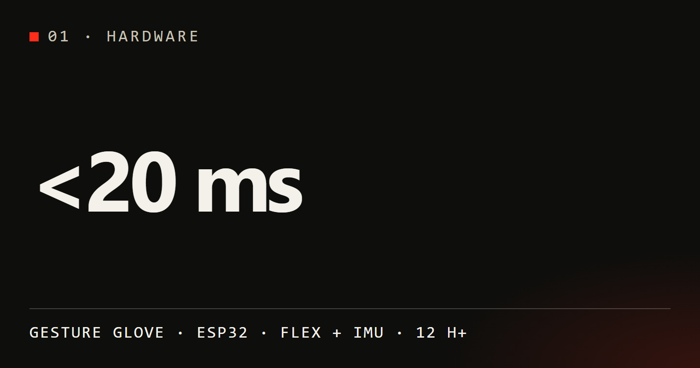
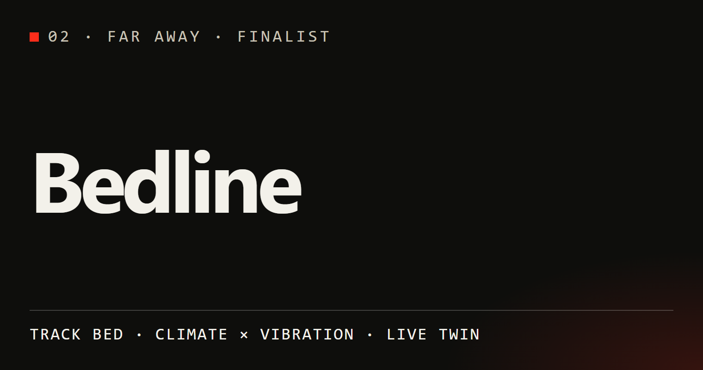
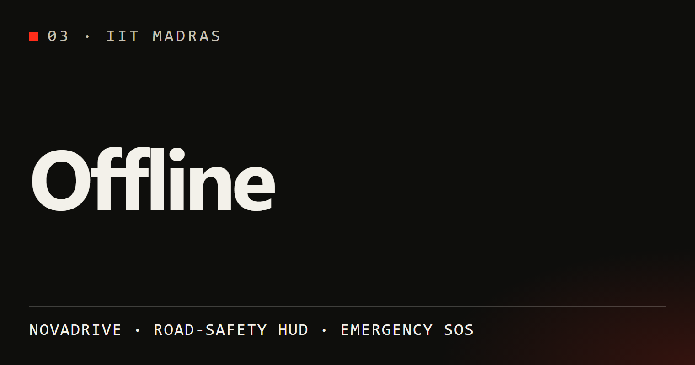
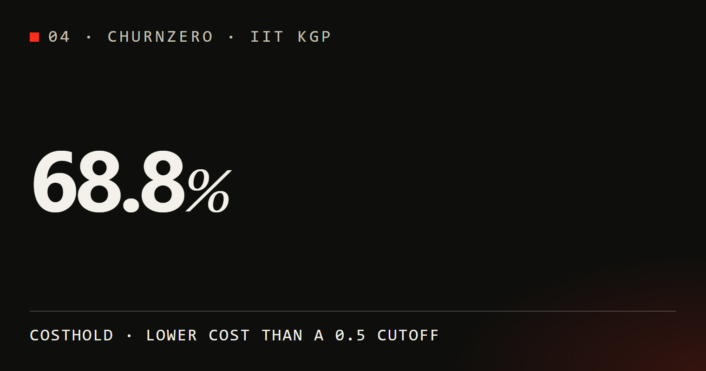
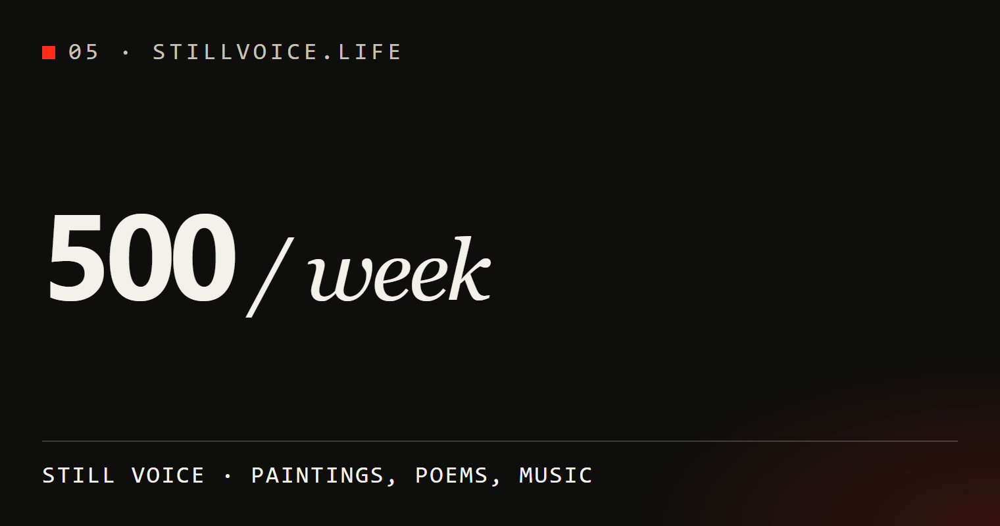
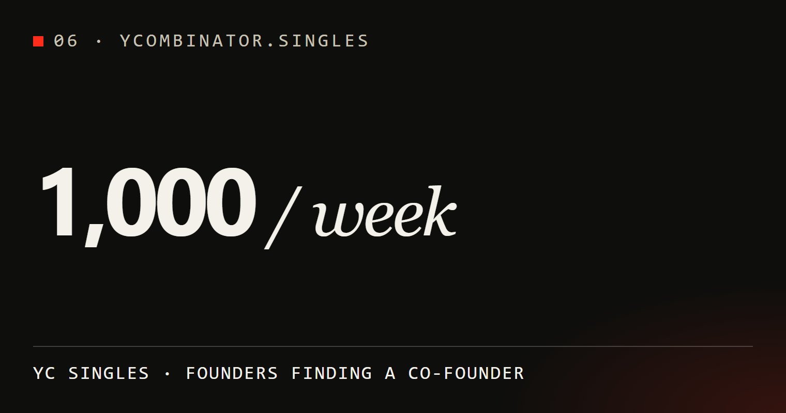

  

  
  
  
  

Hardware on the wrist. A railway twin for the track bed. Two waitlists that filled inside a week.

## Work

<table>
  <tr>
    <td width="50%">
      
    </td>
    <td width="50%">
      
    </td>
  </tr>
  <tr>
    <td>
      <b>Gesture Glove</b> 
      ESP32, flex sensors, and an IMU. C++ on the board. Gesture to speech in under 20 ms. 12+ hours on a charge.
    </td>
    <td>
      <b><a href="https://bogieflow.vercel.app">BogieFlow</a></b> · Far Away 2026, finalist 
      Live digital twin for railway track-bed maintenance. Climate and vibration. React, FastAPI, WebSocket. 
      <a href="https://github.com/Saylichangn/Bogieflow">Source</a>
    </td>
  </tr>
  <tr>
    <td width="50%">
      
    </td>
    <td width="50%">
      
    </td>
  </tr>
  <tr>
    <td>
      <b><a href="https://github.com/Stormynubee/Margi">NovaDrive</a></b> · Margi, IIT Madras 
      Offline-first road-safety HUD and emergency SOS for when the network is already gone. React Native, Expo, TypeScript.
    </td>
    <td>
      <b><a href="https://github.com/Saylichangn/retainiq-churnzero-26">RetainIQ</a></b> · ChurnZero, IIT Kharagpur 
      Cost-aware churn model and a causal uplift layer. LightGBM and CatBoost. PR-AUC 0.9999. 4 persuadable, 141 sleeping dogs, out of 8,101.
    </td>
  </tr>
  <tr>
    <td width="50%">
      
    </td>
    <td width="50%">
      
    </td>
  </tr>
  <tr>
    <td>
      <b><a href="https://stillvoice.life/">Still Voice</a></b> 
      A quiet room for paintings, poems, photographs, music, and stories by real artists. 500 names in a week.
    </td>
    <td>
      <b><a href="https://www.ycombinator.singles/">YC Singles</a></b> 
      A founders' app for finding a co-founder. 1,000 names in a week.
    </td>
  </tr>
</table>

## Also built

**[BizCatcher](https://github.com/Saylichangn/BizCatcher)** — serverless geofencing and lead discovery. Next.js, OpenStreetMap, live filters, CSV export.

**[MineHealth](https://github.com/Saylichangn/MineHealthftw)** — gamified life OS and study companion. JEE tracking and health logs. React, FastAPI, MongoDB.

**Desk Assistant** — physical desk companion for UMANG OS. Gesture control, recognition, focus mode, real-time feedback.

**Study sites** — [chemistry](https://ncert-chemistry-site.vercel.app/), [f-block](https://fblock-one.vercel.app/), [fluid mechanics](https://fluid-mechanics-web.vercel.app/).

**[Buy Me a Shirt](https://buymeashirt.vercel.app/)** · automation for a go-kart racing team.

## Stack

  
  
  
  

  
  
  
  
  
  

  
  
  
  
  
  

## Record

50+ hackathons. 14 finalist finishes.

<table>
  <tr>
    <td>Far Away Hackathon </td>
    <td>CodeFusion 2K26 </td>
    <td>Hack the Den </td>
  </tr>
  <tr>
    <td>Tradition Hacks </td>
    <td>TRIQ </td>
    <td>Build-a-thon </td>
  </tr>
  <tr>
    <td>National Buildathon </td>
    <td>eRaksha, IIT Delhi </td>
    <td>TechJam 2.0 </td>
  </tr>
  <tr>
    <td>ISIR </td>
    <td>HackDay 1.0 </td>
    <td>Prayas </td>
  </tr>
</table>

  
<b>Paper, letters, and the art wall</b>

   

CS50, Harvard. SystemVerilog, BITS Pilani. Rhapsody Hackathon, IISc Bangalore. ChurnZero. Crisis Lens, USAII 2026 Challenge 1A. Techfest, IIT Bombay, participant. Letter of recommendation, Cornell University. IIT Bombay alumni.

National awards in art and street play. Art exhibitions at Delhi Public School, 2022 and 2023. National medal, art and poetry, Birla School, Maharashtra. School medals in art. Graphic design courses.

## Languages

हिंदी · English · मराठी · 日本語

[+91 7208201813](tel:+917208201813)
