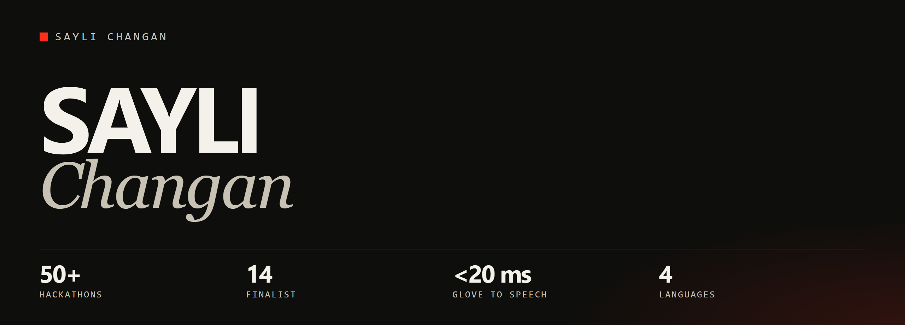

Hardware on the wrist. A railway model that reads the track bed. Two waitlists that filled inside a week.

## Selected work

**Gesture Glove**
ESP32, flex sensors, and an IMU on the device. C++ firmware. A gesture becomes speech in under 20 ms, and the battery lasts past 12 hours.

**[BogieFlow](https://bogieflow.vercel.app)** · Far Away 2026, finalist
Live digital twin for railway track-bed maintenance. Climate and vibration, read together. React, FastAPI, WebSocket. [Source](https://github.com/Stormynubee/Bogieflow)

**[NovaDrive](https://github.com/Stormynubee/Margi)** · Margi, IIT Madras RoadSoS 2026
Offline-first road-safety HUD and emergency SOS for the stretch after a crash, when the network is already gone. React Native, Expo, TypeScript.

**[RetainIQ](https://github.com/Stormynubee/retainiq-churnzero-26)** · ChurnZero 26, IIT Kharagpur
Cost-aware churn model with a causal uplift layer. LightGBM and CatBoost. PR-AUC 0.9999. Cost 68.8% lower than a 0.5 cutoff. 4 persuadable customers and 141 sleeping dogs, out of 8,101.

**[Still Voice](https://stillvoice.life/)**
A quiet room for paintings, poems, photographs, music, and stories by real artists. 500 people joined the waitlist in a week.

**[YC Singles](https://www.ycombinator.singles/)**
A founders' app for finding a co-founder. 1,000 people joined the waitlist in a week.

## Also

[BizCatcher](https://github.com/Stormynubee/BizCatcher), serverless geofencing and lead discovery. [MineHealth](https://github.com/Stormynubee/MineHealthftw), a gamified life OS and study companion. Desk Assistant for UMANG OS. Study sites for [chemistry](https://ncert-chemistry-site.vercel.app/), the [f-block](https://fblock-one.vercel.app/), and [fluid mechanics](https://fluid-mechanics-web.vercel.app/). [Buy Me a Shirt](https://buymeashirt.vercel.app/). Automation for a go-kart racing team.

## Record

50+ hackathons. 14 finalist finishes.

Far Away Hackathon · CodeFusion 2K26 · Hack the Den · Tradition Hacks · TRIQ · Build-a-thon · National Buildathon · eRaksha, IIT Delhi · TechJam 2.0

Qualified: ISIR, HackDay 1.0. Prayas, repository selected.

CS50, Harvard. SystemVerilog, BITS Pilani. Rhapsody, IISc Bangalore. ChurnZero. Crisis Lens, USAII 2026 Challenge 1A. Techfest, IIT Bombay. Letter of recommendation, Cornell University.

National awards in art and street play. Exhibitions at Delhi Public School, 2022 and 2023. National medal, art and poetry, Birla School, Maharashtra.

Hindi · English · Marathi · Japanese

[+91 7208201813](tel:+917208201813)
